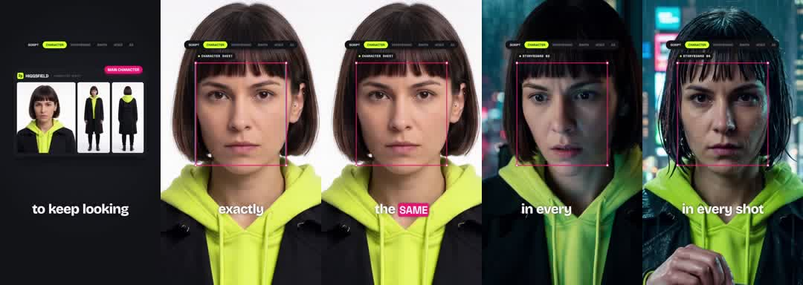

# v07_s09 · full_screen_capture · 21.6–23.2s (calidad 5)

- **Guion:** exactly the same in every shot,
- **Qué se ve:** Retrato de la actriz a pantalla completa con recuadro magenta de detección de cara (22.0) y luego el mismo encuadre en un plano lluvioso nocturno con el mismo recuadro (22.5). Barra de pestañas arriba. (observado)
- **Diseño:** Recuadro de cara magenta fino con puntos en esquinas; 'SAME' en caja magenta; caption blanco y≈57 %.
- **Efectos:** Grade cinematográfico teal/neón en el plano lluvioso.
- **Animación:** Corte seco a 21.9 y match-cut a 22.5 (mismo encuadre de cara, distinto fondo).
- **Por qué aquí:** Consistencia del personaje demostrada con un match-cut.
