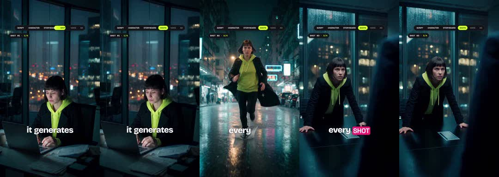

# v07_s12 · full_screen_capture · 26.0–27.1s (calidad 5)

- **Guion:** generates every shot,
- **Qué se ve:** Tres planos generados a pantalla completa en cortes rápidos (mujer en escritorio, corriendo bajo la lluvia, arrodillada) con la barra de pestañas SHOTS arriba. (observado 26.0–26.75)
- **Diseño:** 'SHOT' caja magenta; caption blanco y≈57 %.
- **Efectos:** Grade cinematográfico nocturno teal/lima.
- **Animación:** Cortes secos cada ~0.35 s (ráfaga).
- **Por qué aquí:** 'Every shot' = ráfaga de planos (cantidad).
