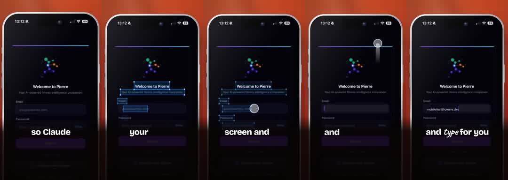

# v10_s05 · full_screen_capture · 8.5–11.5s (calidad 5)

- **Guion:** so Cloud can read your phone screen and tap, swipe, and type for you.
- **Qué se ve:** Marco de iPhone grande (x 6–91 %, desde y 7.5 % y sangra abajo) con la app 'Welcome to Pierre': aparecen cajas azules sobre cada elemento de UI (lectura de accesibilidad, 9.25), círculo de toque (9.75), deslizamiento (10.5) y texto que se escribe en Email (10.75–11.0). (observado)
- **Diseño:** Cajas azules finas con etiquetas; 'tap', 'swipe', 'type' en script itálica; caption y≈73 %.
- **Efectos:** Lienzo negro/naranja oscuro detrás del móvil.
- **Animación:** Móvil entra subiendo con leve escala (~0.2 s, 8.3); overlays sincronizados a cada verbo.
- **Por qué aquí:** Cada verbo (read, tap, swipe, type) tiene su prueba visual exacta.
