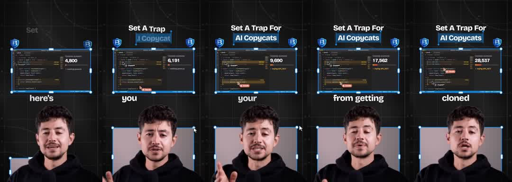

# v01_s01 · hook_title · 0.0–1.9s (calidad 5)

- **Guion:** Here's how you can protect your app from getting cloned
- **Qué se ve:** [obs] Lienzo negro con cuadrícula; título 'Set A Trap For' / 'AI Copycats' arriba con escudo 'B' azul a cada lado; debajo ventana de VS Code (game.js) con panel 'TOKENS BURNED' cuyo número sube (4,800→20,877); abajo Nick en recuadro con marco azul. Caption 'you can protect' con 'protect' en azul.
- **Diseño:** [obs] Línea 1 sans black/heavy blanca (tipo Inter Black), ~3.4 % alto, y 13.9–17.3 %; línea 2 'AI Copycats' sans bold blanca dentro de caja azul marino translúcida (#0E4070 aprox.) con barras verticales azules y puntos en los extremos (como selección de texto), y 19.4–22.8 %. Escudos azules a x≈10 % y ≈90 %. Ventana y 26.8–49.9 %, x 9.8–89.1 %. Caption sans bold blanca ~4.4 % alto centrada en y≈54 %; palabra clave en azul #1E8BFF aprox. (misma sans).
- **Efectos:** [obs] Cuadrícula fina gris + arcos/reglas tipo plano CAD ('R18', '45°', números 10/15/20 en el borde). Sin grano visible. [inf] leve viñeta oscura en bordes.
- **Animación:** [obs] Frame 0 ya muestra ventana; el recuadro de la cara se 'dibuja' desde abajo-izquierda hacia arriba-derecha (0.13→0.33 s) con un cursor de flecha en su esquina (como arrastrar un marco en Figma). Título write-on por palabra con fade desde gris: 'Set' 0.13, 'Set A' 0.33, 'Trap' 0.53, 'For' 0.67; la caja de 'AI Copycats' se abre en ancho 0.33→0.6 s. Captions acumulan palabra a palabra, la nueva entra en gris y pasa a blanco en ~2 frames. Contador sube continuo. Sensación seca y rápida.
- **Por qué aquí:** [inf] Hook: promesa concreta ('protege tu app') + visual de la herramienta funcionando desde el frame 0 + cara para conexión. El contador que sube ya enseña el resultado (tokens quemados) antes de explicarlo.
