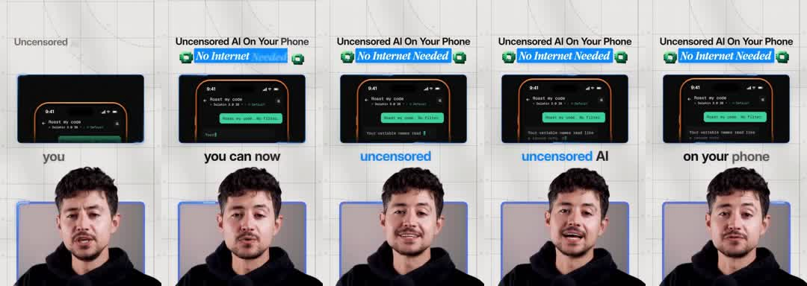

# v02_s01 · hook_title · 0.0–1.9s (calidad 5)

- **Guion:** You can now run uncensored AI on your phone
- **Qué se ve:** [obs] Lienzo claro con cuadrícula. Título 'Uncensored AI On Your Phone' / 'No Internet Needed' con icono de chip verde a cada lado; debajo ventana apaisada con la parte superior de un iPhone (marco naranja) mostrando el chat 'Roast my code' con respuesta tecleándose; abajo Nick en recuadro azul. Caption 'uncensored' en azul.
- **Diseño:** [obs] Línea 1 sans bold negra ~2.1 % alto, y≈17–19 %; línea 2 serif itálica bold blanca (tipo Playfair/Instrument Serif Italic) dentro de caja azul #1C80EC, y≈20.7–22.5 %. Ventana x 10.3–88.5 %, y 26–50 % (78 × 24 %), borde azul grueso (~10 px) con esquinas redondeadas, sin asas visibles. Caption sans bold ~4 % alto, y≈54–56 %; palabra clave azul #1E80F0 aprox.
- **Efectos:** [obs] Cuadrícula gris fina + trazos CAD (arcos) sobre gris cálido claro #CAC8C5–#E6E4E2. Sombra suave bajo la ventana [inf].
- **Animación:** [obs] El iPhone sube dentro de la ventana desde abajo (0.0–0.13). Título write-on por palabra desde gris: 'Uncensored' 0.07, 'AI' 0.13, 'On' 0.2, 'Your Phone' 0.4–0.6; caja azul se abre 0.2–0.33 y 'No'→'Internet'→'Needed' 0.33–0.53; chips entran 0.4. Captions palabra a palabra gris→blanco.
- **Por qué aquí:** [inf] Hook: promesa polémica ('uncensored') + 'en tu móvil' + demo real del chat contestando; cara para credibilidad.
