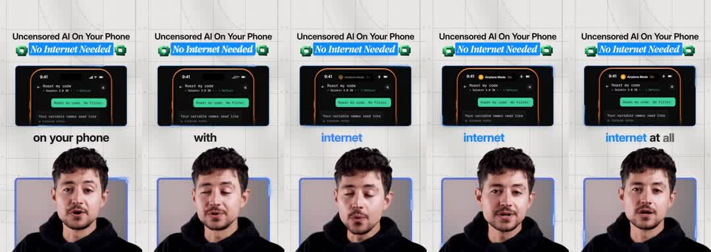

# v02_s02 · hook_title · 1.9–3.0s (calidad 4)

- **Guion:** with no internet at all
- **Qué se ve:** [obs] Mismo layout; en el teléfono aparece el indicador 'Airplane Mode' (naranja) en la barra de estado. 'internet' en azul.
- **Diseño:** [obs] Igual que s01.
- **Efectos:** [obs] Igual que s01.
- **Animación:** [obs] Solo captions y cambio de la barra de estado del teléfono (~2.7). Sale con corte seco a cara en 3.14.
- **Por qué aquí:** [inf] Prueba literal de 'sin internet': modo avión visible.
