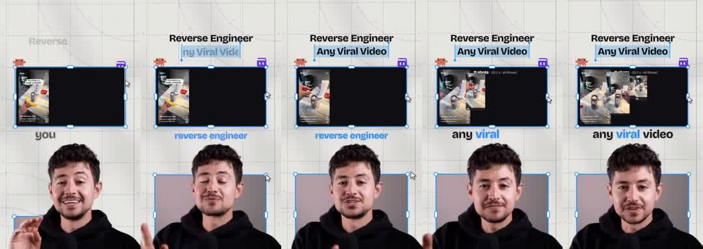

# v03_s01 · hook_title · 0.0–1.9s (calidad 5)

- **Guion:** You can now reverse engineer any viral video
- **Qué se ve:** [obs] Lienzo claro con cuadrícula; título 'Reverse Engineer' / 'Any Viral Video' con robot pixel rojo a la izquierda y logo morado de rea-video a la derecha; ventana apaisada oscura de la app con un reel (vaso + botella) a la izquierda; Nick en recuadro azul con asas. Caption 'reverse engineer' en azul.
- **Diseño:** [obs] Línea 1 sans black casi negra (#101010) ~2.5 % alto, y≈13.5–16.5 %; línea 2 sans bold oscura dentro de un resaltado azul claro tipo selección de texto (#A8C8E8) con barras/caret azules y punto en el extremo, y≈18.5–21.5 %. Ventana x 9.8–89.1 %, y 26.8–50.7 % (79 × 24 %); borde azul #1B88EB ~5 px + asas (círculos en esquinas, píldoras en medios). Caption sans bold y≈54 %.
- **Efectos:** [obs] Lienzo #D6D6CF–#E5E5DE con cuadrícula fina y arcos CAD. Sin grano.
- **Animación:** [obs] Recuadro de cara se dibuja desde abajo-izquierda con cursor (0.13–0.4). Título write-on: 'Reverse' 0.13 (gris→negro), 'Engineer' 0.27, resaltado de la línea 2 se extiende 0.33–0.47 como selección de texto y el texto aparece 0.53–0.67. Caption palabra a palabra gris→negro/azul.
- **Por qué aquí:** [inf] Hook: promesa grande ('cualquier video viral') + la herramienta ya cargando un reel + cara.
