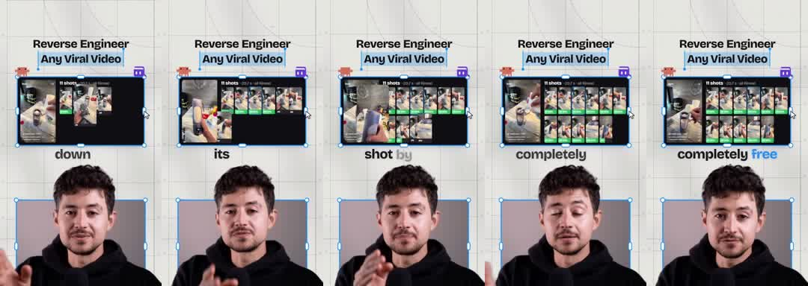

# v03_s02 · hook_title · 1.9–4.4s (calidad 4)

- **Guion:** down to its frame, shot by shot, completely free,
- **Qué se ve:** [obs] Mismo layout; en la ventana aparecen '11 shots' y una rejilla de miniaturas con etiquetas verdes que se rellena de izquierda a derecha. 'free' en azul.
- **Diseño:** [obs] Igual que s01.
- **Efectos:** [obs] Igual que s01.
- **Animación:** [obs] Miniaturas entran en cascada 1.25–3.0 s; sin cambios de layout. Sale con corte a lienzo oscuro en 4.44.
- **Por qué aquí:** [inf] 'shot by shot' literal: la rejilla de planos se construye mientras lo dice.
