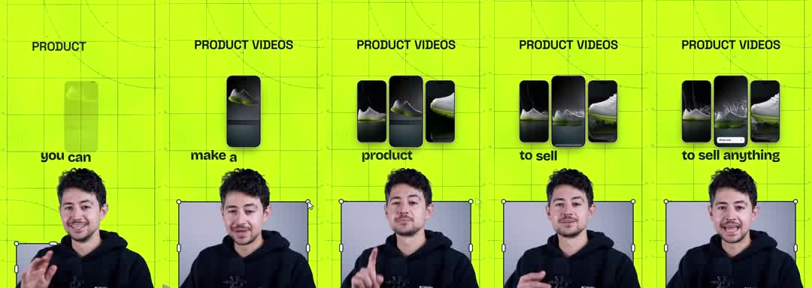

# v04_s01 · hook_title · 0.0–2.2s (calidad 5)

- **Guion:** You can now make a stunning product video to sell anything
- **Qué se ve:** [obs] Lienzo verde lima con cuadrícula; título 'PRODUCT VIDEOS' arriba; debajo 3 móviles con fotos de una zapatilla blanca/verde salpicando agua (el central más grande, con botón 'Shop now'); Nick abajo en recuadro gris con marco y asas. Caption 'make a STUNNING' con STUNNING en caja magenta.
- **Diseño:** [obs] Título sans bold MAYÚSCULAS negra (grotesca algo condensada) ~2.5 % alto, y≈13–16.5 %. Móviles y 28.7–49.5 %, centrados. Caption sans bold negra ~4 % y≈54 %; palabra clave MAYÚSCULAS sans bold blanca en caja magenta #F82070. Recuadro de cara x≈10–90 %, top y=69.8 %, marco negro fino con asas cuadradas blancas.
- **Efectos:** [obs] Lienzo lima #C0F010–#C8F010 con cuadrícula verde oscuro fina y arcos CAD. Sin grano.
- **Animación:** [obs] Recuadro de cara se dibuja desde abajo-izq (0.13–0.33) con cursor. 'PRODUCT' 0.07 gris→negro, 'VIDEOS' 0.27. Móvil central aparece con fade 0.13–0.2; los laterales se despliegan desde detrás 0.67–0.75. 'STUNNING' pop en caja 0.6.
- **Por qué aquí:** [inf] Hook: resultado final (vídeos de producto bonitos) mostrado antes de explicar cómo; lima = marca de este vídeo.
