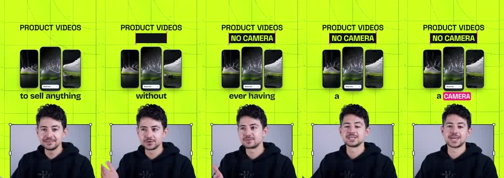

# v04_s02 · hook_title · 2.2–3.4s (calidad 4)

- **Guion:** without ever having to touch a camera.
- **Qué se ve:** [obs] Aparece la línea 2 del título 'NO CAMERA' en lima sobre caja negra; los móviles muestran nuevas imágenes. 'CAMERA' en caja magenta.
- **Diseño:** [obs] 'NO CAMERA' sans bold MAYÚSCULAS lima (#C8F810) sobre caja negra #101010 con asa/punto en esquina, y≈18–21.5 %.
- **Efectos:** [obs] Igual que s01.
- **Animación:** [obs] 'NO CAMERA' write-on por letra/máscara 2.5–2.75 en 'ever'; 'CAMERA' magenta pop 3.25.
- **Por qué aquí:** [inf] La segunda línea del título llega tarde, justo con la objeción ('sin cámara') para reforzarla.
