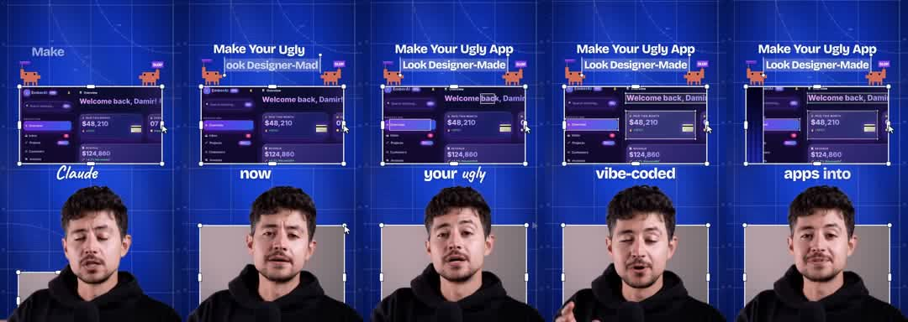

# v05_s01 · hook_title · 0.0–2.2s (calidad 5)

- **Guion:** Claude can now turn your ugly, vibe-coded apps into
- **Qué se ve:** [obs] Lienzo azul real con cuadrícula de plano; título 'Make Your Ugly App' / 'Look Designer-Made' con cangrejos pixel naranjas (icono Claude) a los lados y etiqueta morada 'SLOP'; ventana con un dashboard morado 'EmberAI – Welcome back, Damir!' (estética IA genérica); Nick abajo en recuadro con marco blanco y asas. 'Claude' y 'ugly' en serif itálica blanca.
- **Diseño:** [obs] Línea 1 sans bold blanca ~2.5 % alto, y≈13.5–16.5 %; línea 2 sans bold blanca sobre resaltado azul claro translúcido (#4060C0–#4868D0) con caret, y 18.2–22.2 %. Ventana x≈10–89 %, y 26.8–50.8 % (79 × 24 %); borde BLANCO ~5 px con asas blancas. Caption y≈54 %.
- **Efectos:** [obs] Lienzo azul #102878 en el centro → #001050 abajo (degradado vertical + viñeta), cuadrícula azul clara fina y arcos tipo plano técnico.
- **Animación:** [obs] Cara se dibuja con cursor desde abajo-izq (0.2–0.4). Título write-on: 'Make' 0.13, 'Your' 0.27, 'Ugly' 0.47, 'App' 0.6; resaltado de línea 2 se extiende 0.4–0.6 y el texto entra 0.53–0.67. Caption gris→blanco por palabra.
- **Por qué aquí:** [inf] Hook con la palabra provocadora ('ugly') y el ejemplo feo en pantalla: el espectador reconoce su problema.
