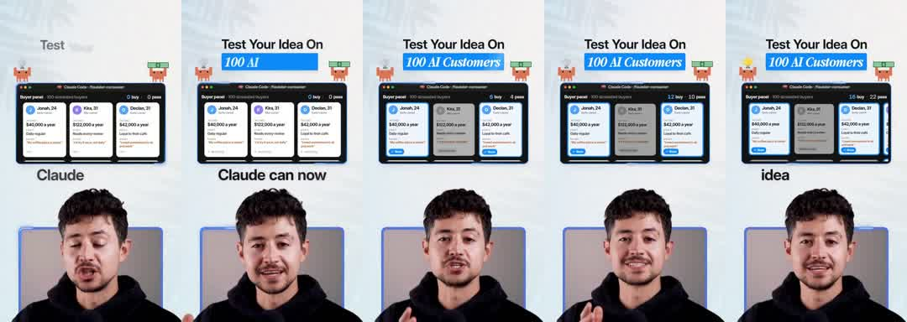

# v06_s01 · hook_title · 0.0–1.8s (calidad 5)

- **Guion:** Claude can now test your business idea on
- **Qué se ve:** Lienzo claro con sombras de hojas de palmera. Arriba título 'Test Your Idea On' + caja azul '100 AI Customers' con dos iconos pixel-art (cangrejo naranja/bombilla a la izquierda, cangrejo con billetes a la derecha). Debajo ventana oscura 'Claude Code · /founder-consumer' con 'Buyer panel · 100 simulated buyers' y 3 tarjetas de comprador (Jonah 24, Kira 31, Declan 31) con ingresos, hábito y duda. Abajo él en recuadro azul. (observado 0.0–1.5)
- **Diseño:** Título línea 1 sans semibold negra (#101010) ~3 % del alto, centrada a ~13.8 % y; línea 2 serif itálica blanca dentro de caja azul #0080F8 (y 16.4–22 %, ~45 % ancho). Iconos pixel-art a ambos lados a y ~17–24 %. Ventana x 9–91 % (82 % ancho) × y 25.6–50.8 %, radio ~2 %, borde azul claro #4F87D4 ~1 % ancho. Caption sans semibold negra ~4 % alto centrada a ~54 %. Recuadro de cara x 10.3–89.7 %, y 70.9 %→sangra por abajo, borde #4F78D3. (observado/medido en fotograma 2.0)
- **Efectos:** Lienzo #E4E8EE con sombra difusa de hojas de palmera (textura de luz natural) en esquinas superiores; sin cuadrícula visible. Ventana con leve sombra. (observado)
- **Animación:** Título write-on por palabra: 'Test' aparece solo en 0.0, 'Your Idea On' en gris claro que pasa a negro; la caja azul aparece con '100' y se completa 'AI Customers' en ~0.5 s (observado 0.0–0.5). Caption palabra a palabra: palabra nueva entra gris y pasa a negro (~2 fr). Sensación seca y rápida.
- **Por qué aquí:** Hook: promesa concreta (cifra 100) en el título + prueba visual inmediata (panel de compradores) + cara visible para conexión.
