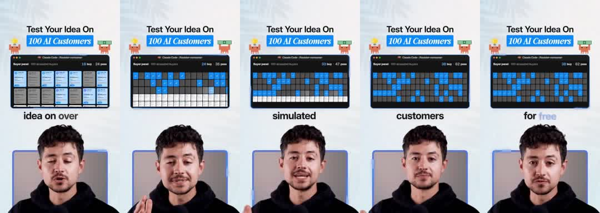

# v06_s02 · hook_title · 1.8–4.4s (calidad 5)

- **Guion:** over a hundred simulated AI customers for free
- **Qué se ve:** Mismo layout; dentro de la ventana las tarjetas se reducen a una rejilla de 100 celdas que se van rellenando de azul (checks) con contador '20 buy · 31 pass' → '38 buy · 62 pass'. (observado 1.75–4.25)
- **Diseño:** Igual que s01. '100' del caption en sans azul #1E88FF aprox; 'free' en azul. (observado 2.0, 4.25)
- **Efectos:** Igual que s01.
- **Animación:** Cambio interno de la ventana en 1.75 s: tarjetas → rejilla (corte interno); celdas se iluminan en azul progresivamente (~2.5 s) y el contador sube. (observado)
- **Por qué aquí:** Dato numérico ('a hundred') visualizado como masa de clientes que deciden: la cifra se vuelve tangible.
