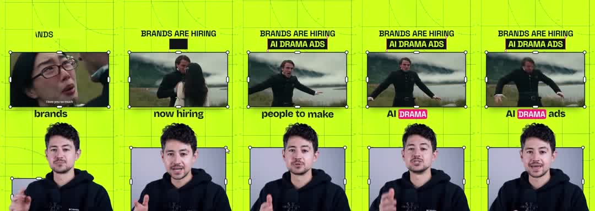

# v07_s01 · hook_title · 0.0–2.3s (calidad 5)

- **Guion:** Brands are now hiring people to make AI drama ads,
- **Qué se ve:** Lienzo verde lima con cuadrícula fina. Arriba título 'BRANDS ARE HIRING' + caja negra 'AI DRAMA ADS'. Debajo ventana 16:9 con clips de drama IA (mujer con gafas 0.0 → hombre en campo con abrigo 0.5–2.25). Abajo él en recuadro con asas blancas tipo Figma. (observado 0.0–2.25)
- **Diseño:** Título línea 1 sans black condensada MAYÚSCULAS negra, y≈15.8–17.3 %; línea 2 MAYÚSCULAS lima #C8F810 sobre caja negra #101010, y≈19.5–23.4 %. Ventana x 8.5–91.5 % × y 24.5–50.8 %, sin radio, borde fino blanco/negro con asas blancas redondeadas en esquinas y centros de lado. Caption sans bold negra ~4 % alto, y≈54 %; 'DRAMA' blanco en caja magenta #F82874. Recuadro cara x 9–91 %, top y≈69.5 %, sangra abajo, mismas asas. (medido 2.0)
- **Efectos:** Lienzo lima #C8F810 con cuadrícula fina de líneas oscuras (~10 % opacidad) y arcos de construcción tipo plantilla técnica; sin grano.
- **Animación:** Título write-on: 'DS'→'BRANDS ARE HIRING' (0.0–0.25), caja negra aparece vacía (0.5) y se rellena con 'AI DRAMA ADS' (0.75). Clips cambian por corte interno cada ~0.5–2 s. Caption palabra a palabra (gris→negro); 'DRAMA' con caja magenta pop a 1.5. (observado)
- **Por qué aquí:** Hook de oportunidad de dinero: titular de noticia + clips reales del producto que se vende (drama IA).
