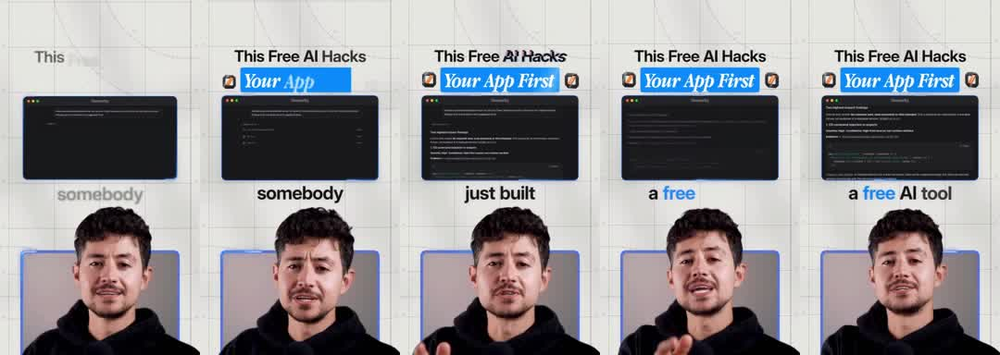

# v08_s01 · hook_title · 0.0–1.7s (calidad 5)

- **Guion:** Somebody just built a free AI tool
- **Qué se ve:** Lienzo gris claro con cuadrícula fina y trazos de construcción. Arriba 'This Free AI Hacks' + caja azul 'Your App First' con dos iconos de app naranja a los lados. Ventana oscura de la app 'Security' con lista de hallazgos. Él abajo en recuadro azul. (observado 0.0–1.5)
- **Diseño:** Título línea 1 sans semibold negra y≈14 %; línea 2 serif itálica blanca en caja #0080F8 y≈19–24 %. Ventana x 8.7–91.3 % × y≈26.9–50.8 %, borde azul ~1 %. Caption sans semibold negra y≈54 %; 'free' en azul. Recuadro de cara x 10.2–89.7 %, top y 71.5 %. (medido en 2.0)
- **Efectos:** Lienzo #D0D0D0–#E0E0D8 con cuadrícula fina gris y arcos/cotas técnicos; glitch momentáneo en 'AI' del título (0.75–1.5).
- **Animación:** Write-on: 'This' + 'Free' gris (0.0), caja azul con 'Your' (0.25), completo a 0.5; 'AI Hacks' con glitch RGB breve. Captions palabra a palabra gris→negro.
- **Por qué aquí:** Hook: beneficio + amenaza ('hackea tu app primero') con prueba de la UI.
