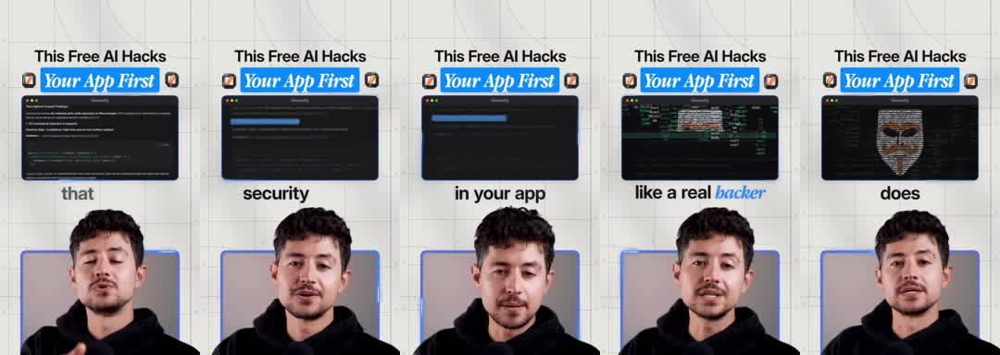

# v08_s02 · hook_title · 1.7–4.9s (calidad 4)

- **Guion:** that finds security holes in your app like a real hacker does,
- **Qué se ve:** En la ventana: línea resaltada en azul (2.25), código con caja naranja contorneada (3.5–3.75) y luego imagen de máscara de Guy Fawkes con matriz de código glitch (4.0–4.75). (observado)
- **Diseño:** 'hacker' en serif itálica azul en el caption. (observado 4.0)
- **Efectos:** Glitch/datamosh sobre la máscara; ruido digital verde.
- **Animación:** Cambios internos de la ventana cada ~0.75 s; máscara entra con glitch (~2 fr).
- **Por qué aquí:** 'Como un hacker real' → icono cultural del hacker (metáfora visual).
