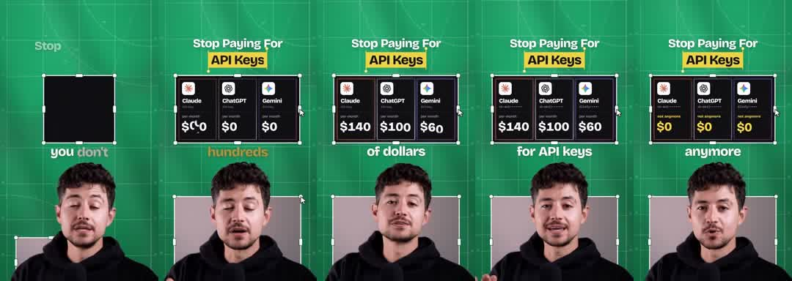

# v09_s01 · hook_title · 0.0–2.7s (calidad 5)

- **Guion:** You don't need to pay hundreds of dollars for API keys anymore.
- **Qué se ve:** Lienzo verde con cuadrícula y luz radial. Arriba 'Stop Paying For' + caja amarilla 'API Keys'. Ventana con 3 tarjetas de precio (Claude, ChatGPT, Gemini 'per month') cuyos importes ruedan $0 → $140 / $100 / $60 y al decir 'anymore' vuelven a $0. Él abajo en recuadro con asas blancas. (observado 0.0–2.5)
- **Diseño:** Título línea 1 sans bold blanca y≈15.5 %; línea 2 sans bold negra en caja amarilla #E8C838 con asas en esquinas, y 18.8–24.2 %. Ventana x 10.5–89.5 % × y 26.9–50.8 %, borde fino blanco con asas blancas (esquinas + centros). Caption sans semibold blanca y≈54 %; 'hundreds' en amarillo. Recuadro cara x 10–89.7 %, top y≈69.8 %. (medido en 1.75)
- **Efectos:** Lienzo verde #107050 (bordes) / #086848 (centro) con cuadrícula fina clara, trazos técnicos y viñeta/luz radial; sin grano.
- **Animación:** 'Stop' aparece solo (0.0) y la ventana entra vacía (negro) y se rellena; título completo a 0.5. Cifras tipo contador 0.75–1.25 y de vuelta a $0 a 2.25 (rueda hacia abajo). Captions gris→blanco.
- **Por qué aquí:** Hook de dolor (pagar mucho) con el número que se anula delante del espectador.
