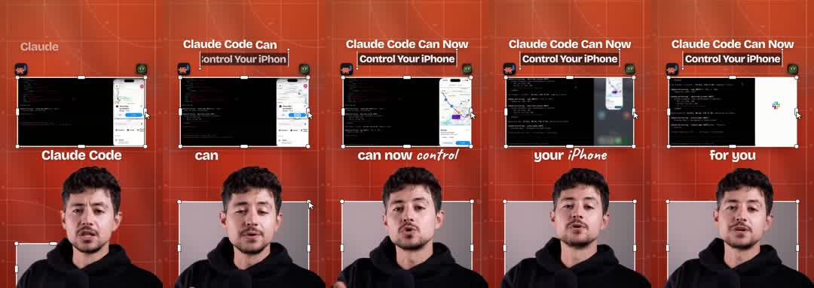

# v10_s01 · hook_title · 0.0–2.2s (calidad 5)

- **Guion:** Cloud Code can now control your iPhone for you,
- **Qué se ve:** Lienzo naranja con cuadrícula fina. Arriba 'Claude Code Can Now' + caja marrón oscuro 'Control Your iPhone' con iconos pixel-art a los lados (cangrejo naranja, robot verde). Ventana con terminal a la izquierda y la pantalla del iPhone espejada a la derecha (apps abriéndose). Él abajo en recuadro con asas blancas. (observado 0.0–2.0)
- **Diseño:** Título línea 1 sans bold blanca y≈15.4 %; línea 2 sans bold blanca en caja #502018 con borde fino blanco, y 18.1–22.6 %. Ventana x 10.5–90 % × y 26.8–50.8 %, borde fino blanco con asas blancas. Caption sans semibold blanca y≈54 %; 'control' e 'iPhone' en script itálica manuscrita blanca. Recuadro cara x 10.5–90 %, top y≈69.9 %. (medido en 1.75)
- **Efectos:** Lienzo naranja #A83818 (bordes) → #902810 (abajo) con cuadrícula fina y trazos técnicos; viñeta.
- **Animación:** Título write-on: 'Claude Code' (0.25) → 'Can Now' → caja 'Control Your iPhone' (0.5); 'now' entra gris. Ventana con cambios internos (Maps 1.5, apps 1.75). Captions gris→blanco.
- **Por qué aquí:** Hook: capacidad nueva + prueba en vivo (el iPhone respondiendo a la terminal).
