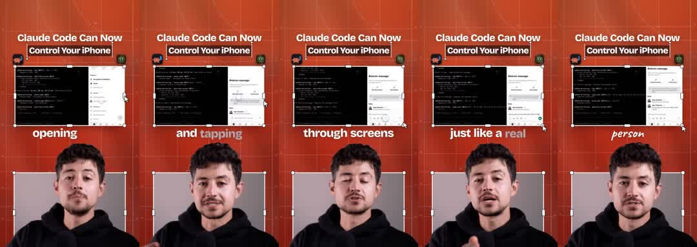

# v10_s02 · hook_title · 2.2–4.9s (calidad 4)

- **Guion:** opening apps and tapping through screens just like a real person.
- **Qué se ve:** Mismo layout; en la ventana el iPhone espejado cambia de pantalla (Mensajes, ajustes) mientras la terminal imprime comandos. (observado 2.25–4.5)
- **Diseño:** 'person' script itálica blanca.
- **Efectos:** Igual.
- **Animación:** Cambios internos cada ~0.5–0.75 s.
- **Por qué aquí:** Describe acciones → la ventana las ejecuta.
