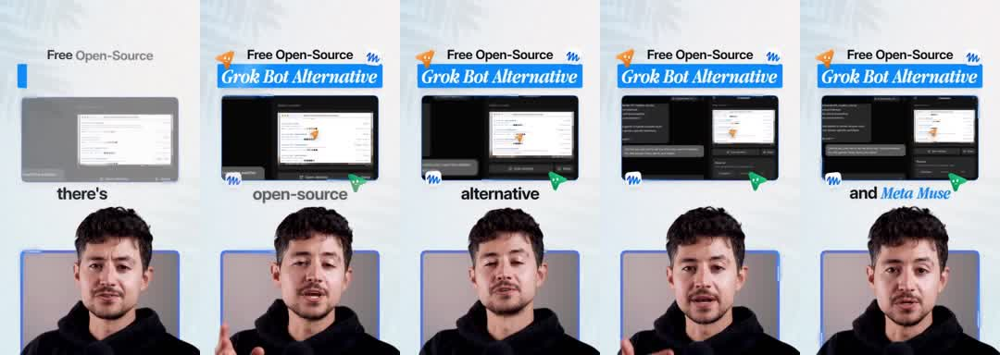

# v11_s01 · hook_title · 0.0–3.0s (calidad 5)

- **Guion:** There's now a free open source alternative to Grockbot and Metamuse,
- **Qué se ve:** [obs 0.25–2.9] Lienzo claro con título de dos líneas arriba ('Free Open-Source' / 'Grok Bot Alternative'), logo-bot naranja a la izquierda y logo 'm' azul a la derecha; debajo ventana oscura con el escritorio virtual de un agente (pantalla 'Atlas's screen' con GitHub trending) y stickers de bots (naranja, verde) y del logo 'm' pegados a las esquinas; subtítulo por palabra; él en recuadro azul abajo con la cabeza saliendo del marco.
- **Diseño:** [obs 1.0, medido] Línea 1 sans grotesca bold negra #111 ~6 % del alto, y≈14–17 %; línea 2 serif itálica bold blanca dentro de caja azul #0282FB rectangular (radio ~6 px) x 9–91 %, y 18.0–24.7 %. Ventana y 26.8–50.8 %, x 11–89 %. Subtítulo sans bold negra ~5 % alto centrado en y≈55 %; 'Grok Bot' y 'Meta Muse' en serif itálica azul (#3D7BF0 aprox.).
- **Efectos:** [obs] Lienzo #DEE8F0 con grano/ruido fino y sombra difusa de hojas de palmera arriba-izquierda (#D0E2EF); sombra suave bajo la caja azul y los stickers.
- **Animación:** [obs 0.0–0.5] Frame 0: lienzo con 'Free' y ventana gris translúcida; en 0.25 la caja azul crece de izquierda a derecha revelando 'Grok' y en 0.5 está completa (≈0.3 s, write-on de caja). La ventana pasa de placeholder gris a contenido (fade ≈0.2 s). Subtítulos: palabra nueva entra gris desenfocada y se enfoca a negro (blur-in ≈0.15 s). Stickers con pop.
- **Por qué aquí:** [inf] Hook: el título promete 'alternativa gratis' a herramientas conocidas; la cara abajo da confianza y la ventana prueba que existe.
