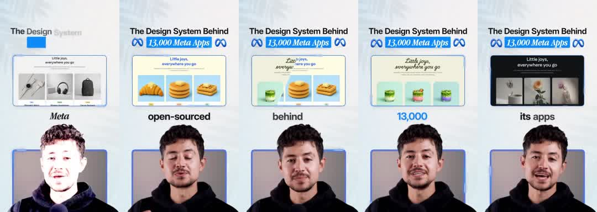

# v12_s01 · hook_title · 0.0–3.8s (calidad 5)

- **Guion:** Meta just open sourced the design system behind over 13,000 of its apps,
- **Qué se ve:** [obs 0.25–3.5] Lienzo claro; título 'The Design System Behind' / '∞ 13,000 Meta Apps ∞' (logos de Meta a ambos lados de la caja azul); debajo ventana con una tienda hecha con el design system que cambia de tema (auriculares → cruasanes → bebidas verdes → versión oscura 'Little joys, everywhere you go'); él en recuadro azul abajo.
- **Diseño:** [medido 1.0] L1 sans bold negra ~4 % alto, y≈13–15 %; L2 serif itálica blanca en caja azul #1681ED, y≈17.4–20.5 %; logos Meta azul a los lados. Ventana y≈23–43 %, x 11–89 %. Subtítulo sans bold negra y≈55 %; '13,000' y 'system' en azul.
- **Efectos:** [obs] Lienzo #DFEAF0 con grano y sombra de palmera; frame 0: la cara del recuadro aparece quemada a blanco (flash) y se normaliza en 0.27 s.
- **Animación:** [obs 0.0–0.5] 'The' → write-on del título; la caja azul se despliega a la izquierda con '13,000' (0.25) y se completa en 0.5; logos Meta pop. Contenido de la ventana cambia de tema cada ~0.75–1 s (0.5, 1.5–2.0, 3.25).
- **Por qué aquí:** [inf] Hook de autoridad: 'Meta' + cifra enorme en la caja azul; la ventana enseña lo bonito del resultado.
