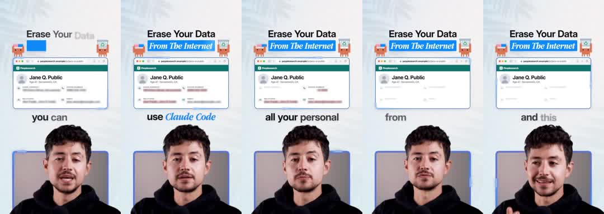

# v13_s01 · hook_title · 0.0–3.5s (calidad 5)

- **Guion:** You can now use Cloud Code to delete all your personal information from the internet, and this is
- **Qué se ve:** [obs 0.25–3.5] Lienzo claro: título 'Erase Your Data' / 'From The Internet' con dos iconos de cangrejo (Claude Code) a los lados; debajo ventana de un sitio de búsqueda de personas ('Peoplesearch') con el perfil 'Jane Q. Public' y sus datos; él en recuadro abajo.
- **Diseño:** [medido 1.0] L1 sans bold negra y≈13–15 %; caja azul #0782F7 y≈18.9–21.5 % con serif itálica blanca; ventana web blanca con cabecera verde #1E6B5A aprox., y≈23–40 %. Subtítulo sans bold negra y≈55 %; 'Claude Code' serif itálica azul, 'delete' azul.
- **Efectos:** [obs] lienzo #DFEAF0 con grano y sombra de palmera; datos del perfil con desenfoque (privacidad) en rojo.
- **Animación:** [obs 0.0–0.5] 'Erase' write-on → caja azul se despliega con 'From' y se completa en 0.5; iconos pop. Ventana: los campos del perfil se desenfocan/desvanecen (2.0–3.0) como si se borraran.
- **Por qué aquí:** [inf] Hook de beneficio personal (privacidad) + herramienta conocida (Claude Code).
