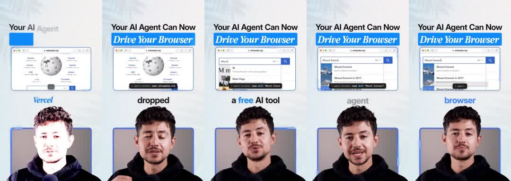

# v14_s01 · hook_title · 0.0–3.8s (calidad 5)

- **Guion:** Bursell just dropped a free AI tool that lets your coding agent control your browser
- **Qué se ve:** [obs 0.25–3.75] Lienzo claro: título 'Your AI Agent Can Now' / 'Drive Your Browser'; ventana con Wikipedia donde un agente teclea 'Mount Everest' en el buscador (chip de terminal negro abajo 'agent-browser type …'); él en recuadro abajo.
- **Diseño:** [medido 1.0] L1 sans bold negra y≈13–15 %; caja azul #0282FB y 18.1–22 % con serif itálica blanca; ventana y≈23–40 %; subtítulo negro y≈55 %, 'Vercel' serif itálica azul (transcrito 'Bursell'), 'free' y 'browser' azul.
- **Efectos:** [obs] lienzo #DFEAF0 con grano y palmera; frame 0 la cara del recuadro quemada a blanco hasta 0.27 s.
- **Animación:** [obs 0.0–0.53] 'Your' → write-on de L1; la caja azul crece de izquierda a derecha y 'Drive Your Browser' se escribe palabra a palabra (0.27–0.53). Dentro: autocompletado y lista de sugerencias aparecen 1.5–3.0.
- **Por qué aquí:** [inf] Promesa clara en el título + demo del agente tecleando = 'lo hace solo'.
