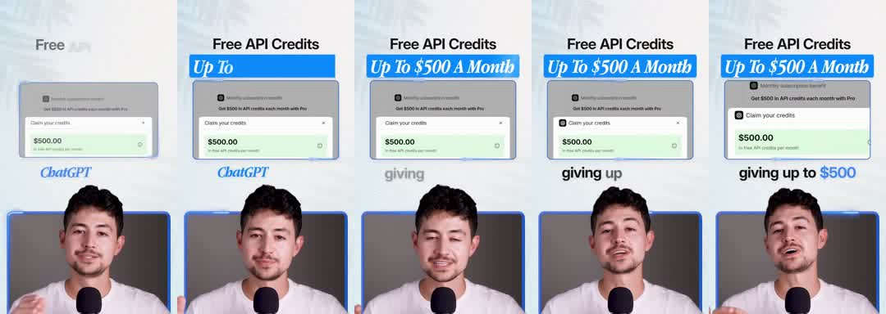

# v16_s01 · hook_title · 0.0–1.8s (calidad 5)

- **Guion:** ChatGBT is now giving up to 500 bucks
- **Qué se ve:** Lienzo claro con sombra de hojas de palmera; arriba título 'Free API Credits' / 'Up To $500 A Month'; debajo ventana con captura de ChatGPT ('Monthly subscription benefit · Get $500 in API credits each month with Pro' + modal 'Claim your credits $500.00'); abajo Nick en recuadro azul con micro. Caption 'ChatGPT is now' → 'giving up to $500'.
- **Diseño:** [observed 0.5] Línea 1 'Free API Credits' sans bold NEGRA (~#111) ~4 % alto, centrada a y≈13 %. Línea 2 'Up To $500 A Month' serif itálica bold blanca sobre caja azul #0A88F8 (x 7–93 %, y 17.3–24.6 %). Sin iconos laterales visibles. Caption: 'ChatGPT' serif itálica bold azul (#2E8BF8 aprox) + 'is now' sans bold negra; '$500' sans bold azul.
- **Efectos:** [observed] Lienzo #E3EDF2 con sombra difusa de hojas de palmera (textura de luz), sin cuadrícula visible. Ventana con borde azul fino y asas en esquinas; recuadro de cara con glow azul suave.
- **Animación:** [observed 0.0→0.5] Título write-on letra a letra con blur (la caja azul aparece vacía en 0.0 y se rellena en ~0.5 s). [observed] Caption palabra a palabra: cada palabra entra en gris translúcido y pasa a blanco/color en ~2 fr. Sensación rápida y limpia.
- **Por qué aquí:** [inferred] Hook: la promesa ($500 gratis) escrita arriba + prueba visual (captura real) + cara = credibilidad en 1 s.
