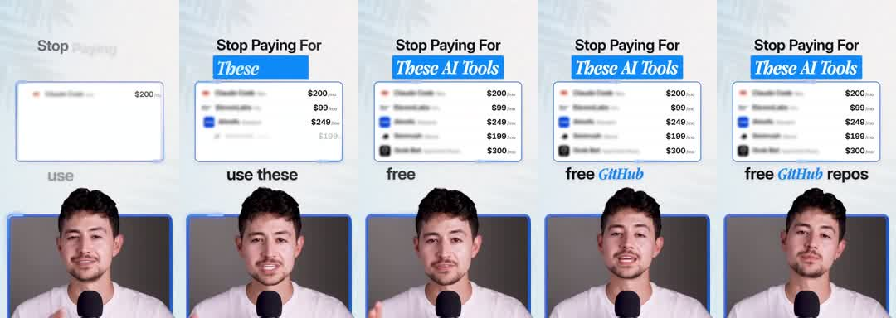

# v17_s01 · hook_title · 0.0–1.5s (calidad 5)

- **Guion:** Use these five free GitHub repos
- **Qué se ve:** Lienzo claro con palmera; título 'Stop Paying For' / 'These AI Tools'; ventana con lista de herramientas y precios (Claude Code $200, ElevenLabs $99, Ahrefs $249, Semrush $199, Grok Bot $300); Nick en recuadro.
- **Diseño:** [observed 1.0] L1 sans bold negra y≈13 %; L2 serif itálica bold blanca en caja #0A88F8 (x 19–81 %, y 17.5–24.7 %). Ventana x 10–90 %, y 25.7–50.8 %. Caption sans bold negra y≈55 %; 'GitHub' serif itálica azul.
- **Efectos:** Sombra de palmera en lienzo; glow azul en recuadro de cara.
- **Animación:** [observed 0.0→0.5] título write-on con caja azul que se rellena; lista de precios se completa fila a fila (0.0→0.5). Caption por palabra gris→negro.
- **Por qué aquí:** [inferred] Hook de ahorro: 'deja de pagar' + la factura que pagas hoy como prueba.
