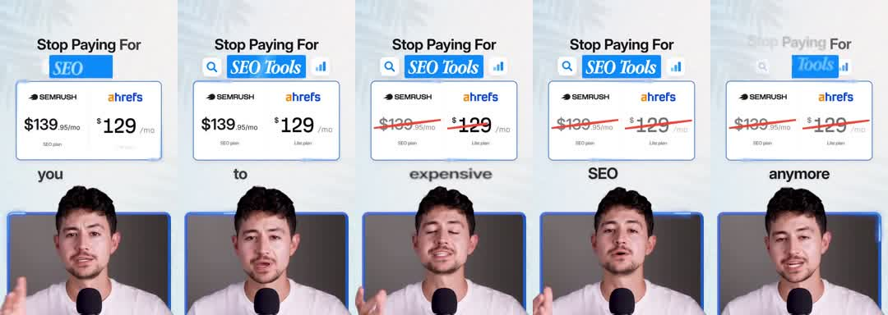

# v18_s01 · hook_title · 0.0–2.4s (calidad 5)

- **Guion:** You don't need to pay for expensive SEO tools anymore.
- **Qué se ve:** Lienzo claro; título 'Stop Paying For' / 'SEO Tools' con icono de lupa a la izquierda y de gráfico de barras a la derecha; ventana con precios Semrush $139.95/mo y Ahrefs $129/mo que se tachan en rojo; Nick en recuadro.
- **Diseño:** [observed 1.0] L1 sans bold negra y≈13 %; L2 serif itálica blanca en caja #0A88F8 (x 28–72 %, y 17.5–24.7 %); iconos en cuadrados azules a ambos lados (x 17–27 % y 73–83 %). Ventana x 10–90 %, y 25.7–50.8 %; precios sans bold grandes; tachado rojo #E0342F. Caption sans bold negra y≈55 %.
- **Efectos:** Palmera; glow azul en recuadro.
- **Animación:** [observed 0.0→0.5] título write-on (caja azul se rellena, iconos pop); [observed 0.5–1.0] tachados rojos se dibujan sobre cada precio; [observed 2.0–2.57] título sale (fade letra a letra + caja se encoge a una línea).
- **Por qué aquí:** [inferred] Hook de ahorro: el precio de las herramientas caras, tachado.
