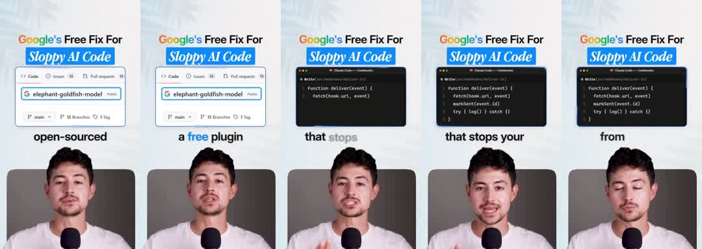

# v19_s02 · hook_title · 1.1–3.1s (calidad 4)

- **Guion:** free plugin that stops your AI from writing
- **Qué se ve:** La ventana pasa (1.8) a una terminal oscura de Claude Code que escribe código en vivo ('function deliver(event) { fetch(hook.url, event) markSent… try { log() } catch {} }').
- **Diseño:** Terminal negra dentro de la misma ventana; caption 'that stops your AI'.
- **Efectos:** —
- **Animación:** [observed 1.8] corte interno; código tecleado línea a línea (1.87–3.0).
- **Por qué aquí:** [inferred] Muestra 'AI writing code' literalmente.
