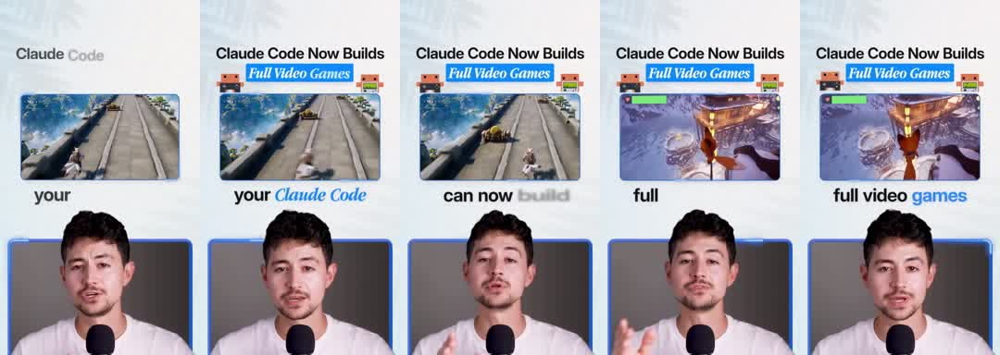

# v20_s01 · hook_title · 0.0–2.2s (calidad 5)

- **Guion:** Your Claude code can now build full video games,
- **Qué se ve:** Lienzo claro; título 'Claude Code Now Builds' / 'Full Video Games' con dos iconos pixel-art de videojuego (coche/robot rojos) a los lados de la caja; ventana con GAMEPLAY en movimiento (personaje corriendo por un puente; 1.5 cambia a un castillo nevado); Nick abajo.
- **Diseño:** [observed 1.0] L1 sans bold negra y≈13 %; L2 serif itálica blanca en caja #0A88F8 (x 23–77 %, y 17.9–23 %, más baja que en v16–v19). Ventana x 11–89 %, y 26.5–50.8 %, borde #2163C4. Caption y≈55 %, 'games' azul.
- **Efectos:** Palmera; iconos pixel-art con color #E87858.
- **Animación:** [observed 0.0→0.5] título write-on con caja que se rellena; [observed 1.5] corte interno a otro clip de juego.
- **Por qué aquí:** [inferred] Hook: promesa + prueba en movimiento (juego real), no captura estática.
