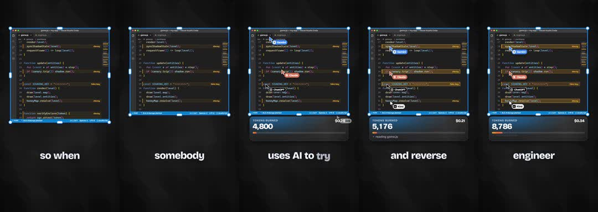

# v01_s08 · window_only · 15.9–18.0s (calidad 5)

- **Guion:** So when somebody uses AI to try and reverse engineer it,
- **Qué se ve:** [obs] La ventana de código se acorta y debajo entra una tarjeta 'TOKENS BURNED 4,800 / $0.20 / reading game.js'; aparecen chips-cursor de agentes (Gemini, Claude, ChatGPT, Kimi) moviéndose sobre las líneas señuelo.
- **Diseño:** [obs] Ventana y 13.2–52.4 %; tarjeta oscura con degradado azul y barra de progreso naranja, y ≈54–66 %, mismo ancho. Chips: píldoras de color con logo (azul Gemini, naranja Claude, negro ChatGPT/Kimi).
- **Efectos:** [obs] Degradado azul en la tarjeta; barra de progreso.
- **Animación:** [obs] 16.55–16.7 la tarjeta aparece con fade desde gris bajo la ventana mientras la ventana encoge; los chips entran en 'AI' (16.6–16.9) y se desplazan como cursores.
- **Por qué aquí:** [inf] 'alguien usa IA' → se ven los agentes (cursores con nombre) atacando el código: personifica la amenaza.
