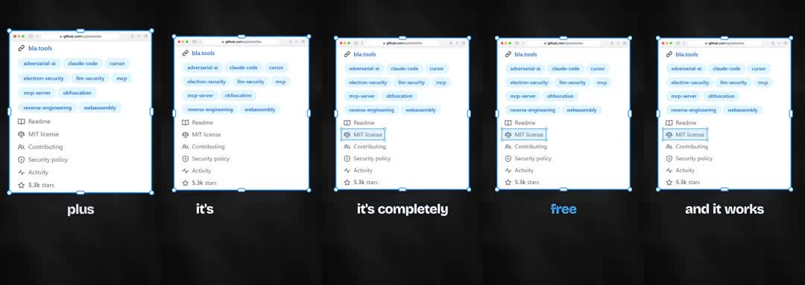

# v01_s12 · window_only · 25.9–27.3s (calidad 3)

- **Guion:** Plus it's completely free and it works
- **Qué se ve:** [obs] Sin cara: ventana blanca del repo de GitHub (bla.tools, etiquetas adversarial-ai, claude-code, cursor…, Readme, MIT license, 5.3k stars). Resaltado en 'MIT license' al decir 'free'.
- **Diseño:** [obs] Ventana ~82 % × 38 % (y ≈27–66 %, centrada más abajo que en frame_split). Caption y≈73 %; 'free' azul.
- **Efectos:** [obs] Ninguno.
- **Animación:** [obs] Corte en 25.85; la ventana aparece grande y se asienta en ~0.2 s; resaltado de 'MIT license' ~26.5.
- **Por qué aquí:** [inf] 'gratis' → prueba visible (licencia MIT, estrellas).
