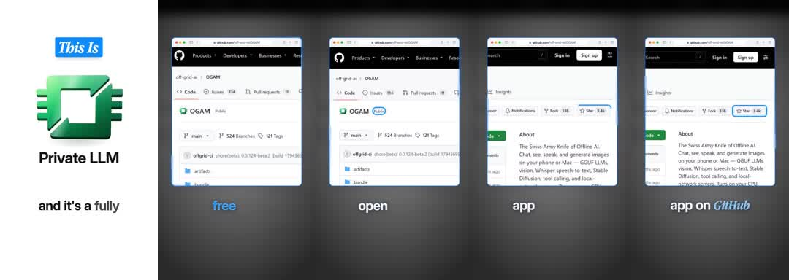

# v02_s05 · window_only · 5.8–7.5s (calidad 3)

- **Guion:** free and open source app on GitHub.
- **Qué se ve:** [obs] Lienzo gris oscuro con foco radial; ventana de navegador con el repo GitHub off-grid-ai/OGAM; se rodea 'Public' con un óvalo azul y luego scroll a 'About' con estrella resaltada. 'free' azul, 'GitHub' serif itálica azul.
- **Diseño:** [obs] Ventana x 8.6–91 %, y 13.3–66.4 % (82 × 53 %), borde azul fino claro; caption y≈73 %, blanca.
- **Efectos:** [obs] Viñeta/foco radial: centro #4B4B4B, bordes casi negros.
- **Animación:** [obs] Corte en 6.09 (a mitad de 'free'); óvalo azul dibujado en 'Public' ~6.4; scroll/cambio a sección 'About' 7.0 con resaltado en 'Star'; sale con glitch 7.57.
- **Por qué aquí:** [inf] 'open source en GitHub' → prueba literal del repo.
