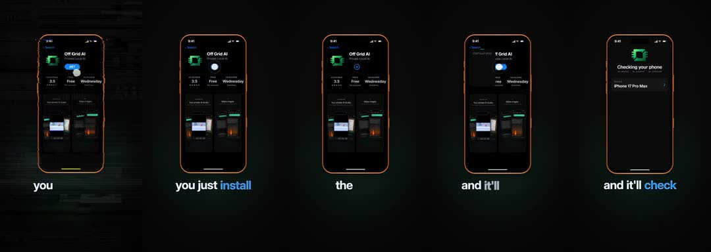

# v02_s06 · window_only · 7.7–9.0s (calidad 4)

- **Guion:** You just install the app and it'll check
- **Qué se ve:** [obs] Lienzo negro, iPhone completo (marco naranja) con la ficha de la app 'Off Grid AI' y un interruptor que se activa; resplandor verde bajo el móvil.
- **Diseño:** [obs] Teléfono x 26–74 % (48 % ancho), y 13.6–69 %; caption sans bold blanca y 72–76 %; 'install' y 'check' en azul.
- **Efectos:** [obs] Negro #090909 con halo verde-azulado difuso detrás de la parte baja del teléfono.
- **Animación:** [obs] Entra tras glitch (7.57–7.7: desgarro horizontal y bloques digitales sobre el teléfono); toggle se activa ~8.2; pantalla cambia a 'Checking your phone' 8.75.
- **Por qué aquí:** [inf] 'instala la app' → se ve la app; el glitch marca el salto de web a móvil.
