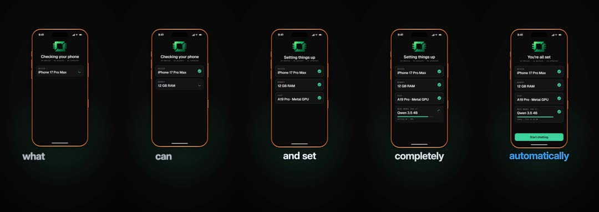

# v02_s07 · window_only · 9.0–12.0s (calidad 4)

- **Guion:** what your phone can handle and set everything up for you completely automatically.
- **Qué se ve:** [obs] En el móvil: 'Checking your phone' con ítems que se marcan con check verde uno a uno (iPhone 17 Pro Max, 12 GB RAM, A19 Pro · Metal GPU), luego 'Setting things up' con barra de descarga de Qwen 3.5 4B y al final 'You're all set' + botón verde 'Start chatting'.
- **Diseño:** [obs] Igual geometría que s06. 'handle' y 'automatically' en azul.
- **Efectos:** [obs] Halo verde.
- **Animación:** [obs] Checks escalonados ~0.25–0.5 s (9.25, 9.5, 10.0), cambio a 'Setting things up' 10.5, barra progresa 10.75–11.5, botón verde aparece 11.75 en 'automatically'.
- **Por qué aquí:** [inf] 'lo configura todo automáticamente' → checklist que se completa sola, recompensa visual en la palabra final.
