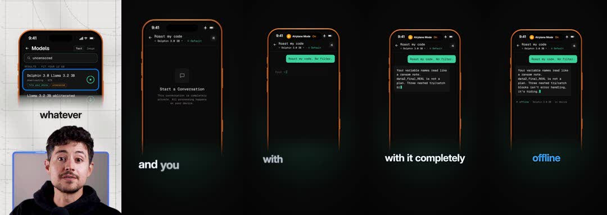

# v02_s10 · window_only · 16.5–18.5s (calidad 4)

- **Guion:** and you can chat with it completely offline.
- **Qué se ve:** [obs] Lienzo negro, iPhone (recortado abajo) con 'Start a Conversation'; aparece 'Airplane Mode', burbuja verde 'Roast my code. No filter.' y respuesta que se teclea.
- **Diseño:** [obs] Teléfono x 20–80 %, y 13.6–63 % (borde inferior fundido); caption y≈72–76 %; 'chat', 'offline' azul.
- **Efectos:** [obs] Halo verde inferior.
- **Animación:** [obs] Corte en 16.83; burbuja aparece en 'chat' (~17.25); respuesta write-on 17.5–18.0.
- **Por qué aquí:** [inf] Demostración del uso principal; 'offline' reforzado por el indicador de modo avión.
