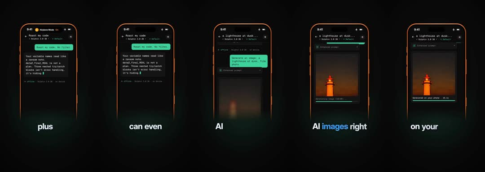

# v02_s11 · window_only · 18.6–20.8s (calidad 4)

- **Guion:** Plus it can even generate AI images right in your phone.
- **Qué se ve:** [obs] El chat sube, aparece burbuja 'Generate an image: a lighthouse at dusk, film photo' y debajo se genera la imagen de un faro al atardecer, del desenfoque a nítida.
- **Diseño:** [obs] Igual geometría; 'generate' e 'images' azul.
- **Efectos:** [obs] Imagen generada pasa de borrosa/ruidosa a nítida (difusión).
- **Animación:** [obs] Burbuja sube con slide 19.35–19.5 en 'generate'; imagen aparece 19.7 y se define hasta ~20.1.
- **Por qué aquí:** [inf] Función extra mostrada en vivo, la imagen cálida rompe el verde/negro.
