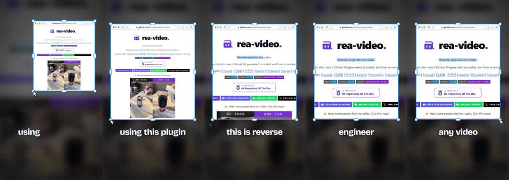

# v03_s03 · window_only · 4.5–7.0s (calidad 4)

- **Guion:** using this plugin. This is Reverse Engineer Any Video,
- **Qué se ve:** [obs] Sin cara; ventana alta con el repo GitHub JuneYaooo/rea-video (logo 'rea-video.', badges, '#1 Repository Of The Day', GIF de demo). Fondo: imagen oscura muy desenfocada. Se resalta 'Reverse-engineer any video.'.
- **Diseño:** [obs] Ventana x 8.4–91.1 %, y 13.2–66.4 % (83 × 53 %); caption blanca y≈73 %.
- **Efectos:** [obs] Lienzo = foto/vídeo muy desenfocado y oscurecido (#18171A–#494949), sin cuadrícula. [inf] es una copia desenfocada del propio contenido/escena.
- **Animación:** [obs] Corte en 4.44; la ventana entra al ~60 % y crece hasta su tamaño en ~0.4 s (4.44–4.84) con cursor en la esquina inferior-izquierda (redimensionado); resaltado azul en 'Reverse-engineer any video' ~5.75.
- **Por qué aquí:** [inf] 'este plugin' → prueba: el repo real; se quita la cara para que se lea.
