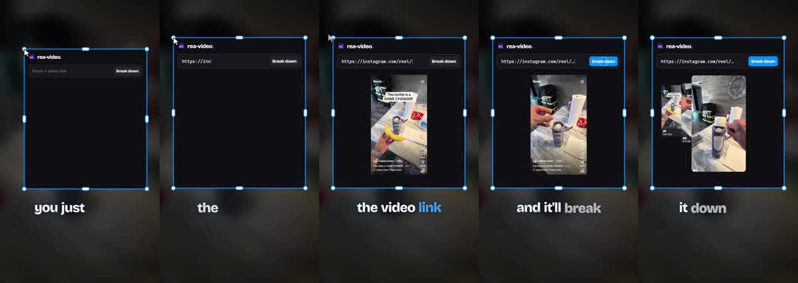

# v03_s05 · window_only · 10.4–12.3s (calidad 4)

- **Guion:** You just give it the video link, and it'll break it down,
- **Qué se ve:** [obs] Lienzo oscuro desenfocado; app rea-video: campo de URL 'https://instagram.com/reel/…' y botón azul 'Break down'; se pega el enlace y aparece el reel.
- **Diseño:** [obs] Ventana 83 × 53 % (y 13.2–66.3 %), UI oscura, botón azul; 'link' azul en caption y≈73 %.
- **Efectos:** [obs] Fondo desenfocado cálido oscuro.
- **Animación:** [obs] Corte en 10.13; ventana entra al ~60 % centrada y crece con cursor en esquina superior-izquierda (10.13–10.6); URL tecleada ~10.75; reel aparece 10.75–11.0.
- **Por qué aquí:** [inf] Paso 1 de uso, literal.
