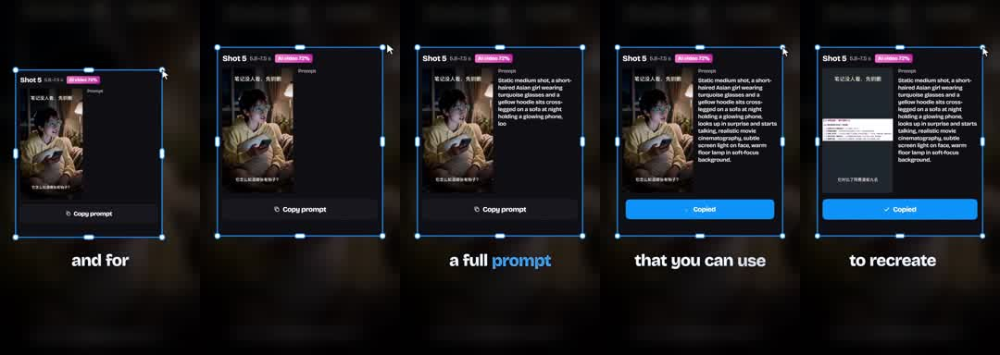

# v03_s10 · window_only · 21.8–25.2s (calidad 4)

- **Guion:** And for each shot, it'll write a full prompt that you can use to recreate it,
- **Qué se ve:** [obs] Lienzo oscuro desenfocado; tarjeta 'Shot 5 · 5.8–7.5 s · AI video 72%' con fotograma (chica con gafas en sofá) y 'Prompt' que se escribe; botón 'Copy prompt' pasa a 'Copied' azul.
- **Diseño:** [obs] Ventana 83 × 53 %; etiqueta rosa 'AI video 72%'; 'prompt' azul en caption y≈73 %.
- **Efectos:** [obs] Fondo desenfocado cálido oscuro (#0D0804).
- **Animación:** [obs] Corte en 21.64; ventana crece desde ~60 % (21.64–22.0) con cursor; texto del prompt write-on 22.75–23.75; botón azul 'Copied' aparece en 24.0 ('can use'); en 25.0 se ve la confirmación pegada.
- **Por qué aquí:** [inf] Muestra la salida más valiosa (el prompt) y el gesto de copiarlo.
