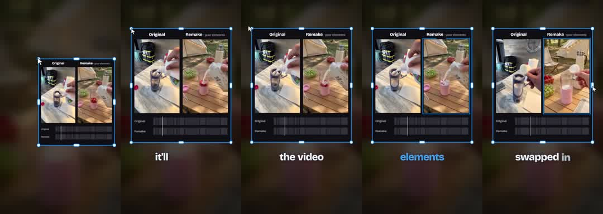

# v03_s13 · window_only · 29.6–32.0s (calidad 5)

- **Guion:** Finally, it'll remake the video with your own elements swapped in,
- **Qué se ve:** [obs] Lienzo oscuro desenfocado; ventana 'Original | Remake (your elements)' con dos vídeos lado a lado (vaso/botella vs. vaso rosa con fresas) y dos pistas de onda debajo.
- **Diseño:** [obs] Ventana 83 × 53 %; 'elements' azul.
- **Efectos:** [obs] Fondo desenfocado cálido (#1D130C–#392A22).
- **Animación:** [obs] Corte en 29.6; ventana crece desde ~60 % (29.63–29.97) con cursor; ambos vídeos se reproducen sincronizados.
- **Por qué aquí:** [inf] El 'wow' final: antes/después lado a lado.
