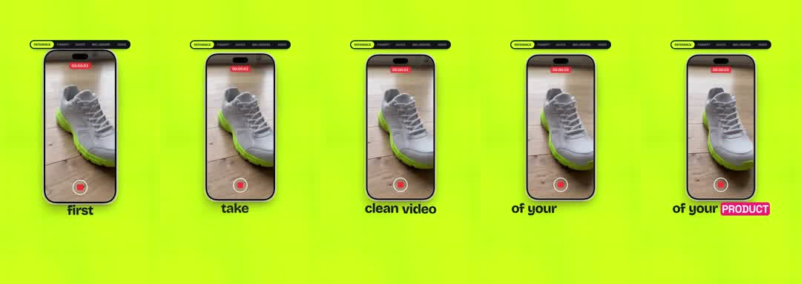

# v04_s03 · window_only · 3.6–5.1s (calidad 4)

- **Guion:** First, take a clean video of your product
- **Qué se ve:** [obs] Sin cara ni título: un iPhone grabando la zapatilla sobre suelo de madera (REC rojo) centrado en el lienzo lima; aparece arriba una barra de pasos en píldora 'REFERENCE · PROMPT · SHOTS · INFLUENCER · VIDEO' con REFERENCE activa. 'PRODUCT' en caja magenta.
- **Diseño:** [obs] Teléfono ~40 % ancho, y≈16–56 %; barra de pasos negra con texto pequeño blanco y paso activo en píldora lima, y≈15 %. Caption y≈54 %.
- **Efectos:** [obs] Sombra suave del móvil sobre el lima.
- **Animación:** [obs] Corte en 3.53; el móvil entra con escala (≈1.05→1.0) y la barra de pasos aparece ~3.6.
- **Por qué aquí:** [inf] Paso 1 dicho = acción mostrada (grabar). La barra de pasos orienta al espectador en el proceso.
