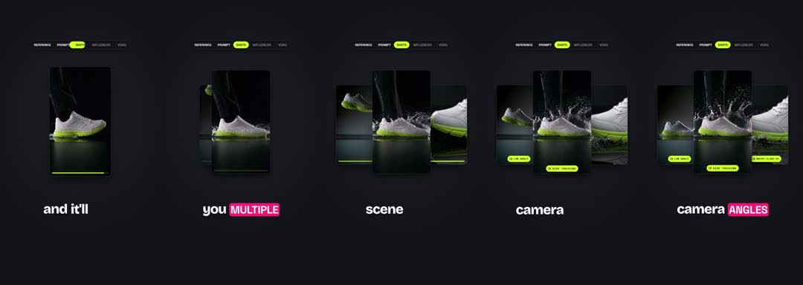

# v04_s07 · window_only · 11.3–13.9s (calidad 5)

- **Guion:** and it'll give you multiple shots of the scene from different camera angles,
- **Qué se ve:** [obs] Lienzo casi negro; barra de pasos con SHOTS activa; carrusel de 3 tarjetas verticales con planos de la zapatilla salpicando (lateral, frontal, otro ángulo) y etiquetas lima debajo.
- **Diseño:** [obs] Tarjetas ~25–35 % ancho, y≈24–60 %, la central delante; caption blanca y≈74 %; 'MULTIPLE', 'ANGLES' en caja magenta.
- **Efectos:** [obs] Fondo #101018 con leve degradado; reflejos/sombras en las tarjetas.
- **Animación:** [obs] Corte en 11.24; tarjeta central sola, laterales se despliegan 11.9–12.5; etiquetas aparecen 13.0–13.25; los vídeos se reproducen.
- **Por qué aquí:** [inf] Resultado (varios ángulos) en negro para que el producto brille.
