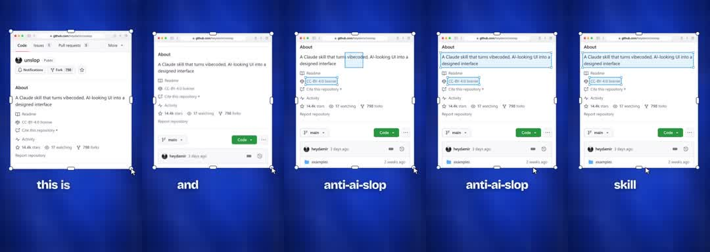

# v05_s03 · window_only · 5.2–8.3s (calidad 3)

- **Guion:** This is Unslop, and it's a free, anti-AI slot design skill
- **Qué se ve:** [obs] Sin cara; ventana alta con el repo GitHub heydamir/unslop ('A Claude skill that turns vibecoded, AI-looking UI into a designed interface'); resaltados en 'CC BY-4.0 license' (en 'free') y en la descripción ('anti-ai-slop').
- **Diseño:** [obs] Ventana x 8.3–91.6 %, y 13.1–66.7 % (83 × 54 %); caption y≈73 %; 'Unslop', 'free' serif itálica.
- **Efectos:** [obs] Lienzo azul.
- **Animación:** [obs] Corte en 5.1; la ventana entra al ~85 % y crece en ~0.3 s; resaltados de texto con marco azul 6.5 y 7.0.
- **Por qué aquí:** [inf] Presentación del nombre con la prueba (repo).
