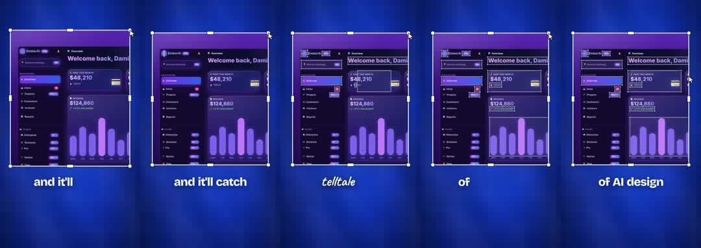

# v05_s07 · window_only · 14.3–16.6s (calidad 4)

- **Guion:** and it'll catch every telltale sign of AI design
- **Qué se ve:** [obs] Sin cara; ventana alta con el dashboard morado completo (barras moradas, tarjetas $48,210 / $124,860); aparecen pequeños marcos de detección sobre elementos. 'telltale' serif itálica.
- **Diseño:** [obs] Ventana 83 × 54 % (y 13.1–66.7 %); caption y≈73 %.
- **Efectos:** [obs] Ninguno.
- **Animación:** [obs] Corte en 14.2; ventana crece desde ~85 % (14.2–14.5); marcos de detección aparecen 15.25–15.75.
- **Por qué aquí:** [inf] Diagnóstico: se señala lo que delata a la IA.
