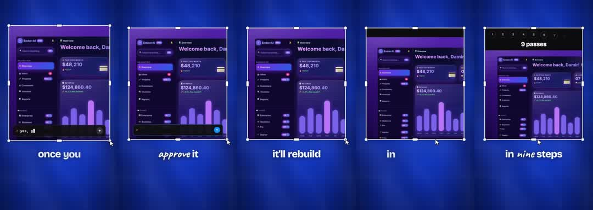

# v05_s10 · window_only · 23.3–26.1s (calidad 4)

- **Guion:** And once you approve it, it'll rebuild every screen in nine steps,
- **Qué se ve:** [obs] Sin cara; dashboard morado con barra de terminal donde se teclea 'yes, go with that'; después el dashboard baja y entra arriba una cabecera negra '9 passes' con 9 círculos numerados.
- **Diseño:** [obs] Ventana 83 × 54 %; cabecera negra con círculos 1–9; 'approve', 'nine' serif itálica.
- **Efectos:** [obs] Ninguno.
- **Animación:** [obs] Corte en 23.15; ventana crece (23.15–23.5); tecleo 23.5–23.8; 25.3–25.6 el contenido se desliza hacia abajo y la cabecera '9 passes' entra desde arriba.
- **Por qué aquí:** [inf] Aprobar = acción literal; 'nine steps' anuncia la estructura que sigue.
