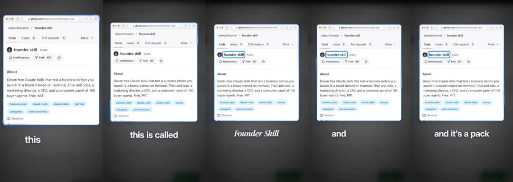

# v06_s04 · window_only · 5.8–7.7s (calidad 4)

- **Guion:** This is called Founder Skill, and it's a pack of
- **Qué se ve:** Lienzo gris oscuro degradado; ventana de navegador blanca con el repo GitHub 'jakeschincariol / founder-skill' (About, tags). Sin cara. (observado 6.0–7.5)
- **Diseño:** Ventana x ~9–91 % × y ~13–66 %, borde azul claro con glow; caption debajo a ~73 %: 'Founder Skill' en serif itálica blanca grande (~5 % alto), resto sans semibold blanca. (observado 6.5)
- **Efectos:** Lienzo gris #2A2A2A→negro con viñeta; leve glow azul del borde.
- **Animación:** Corte seco a 5.77; la ventana aparece ya montada con un leve fade/zoom de ~0.2 s (inferido de 5.75–6.0). 'this is called' palabra a palabra; 'Founder Skill' entra de golpe en serif.
- **Por qué aquí:** Nombra la herramienta → se muestra su fuente real (prueba de que existe).
