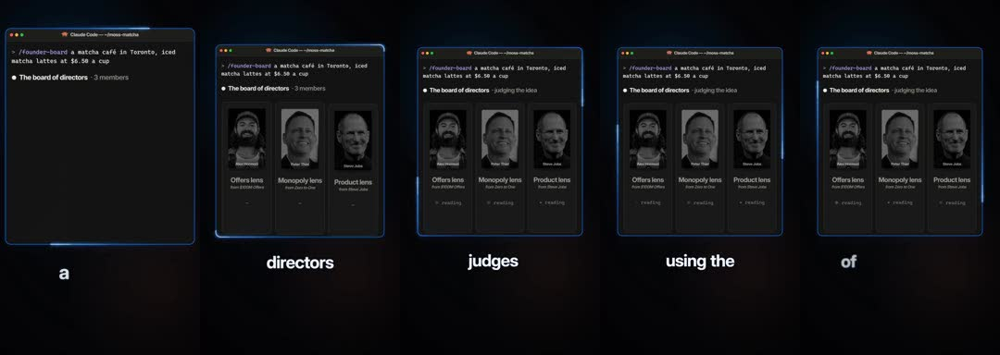

# v06_s08 · window_only · 13.2–15.7s (calidad 5)

- **Guion:** a board of directors judges it using the frameworks of
- **Qué se ve:** Lienzo negro; ventana oscura '/founder-board' con 'The board of directors · 3 members' y tres retratos B/N (Hormozi, Thiel, Jobs) con 'Offers lens / Monopoly lens / Product lens'. (observado 13.5–15.5)
- **Diseño:** Ventana x 8–92 % × y 13–66.5 %, borde azul #1052AF con glow azul en esquina inferior izquierda (asa/luz). Caption blanco a ~73 %; 'board' serif itálica azul. (observado 13.9 / 14.0)
- **Efectos:** Lienzo #000000 con leve luz azul marino; glow exterior del borde.
- **Animación:** Corte seco a ~13.25; el contenido aparece en cascada: texto, luego retratos que se encienden de gris a B/N nítido uno a uno (~0.25 s cada uno). (observado 13.25–14.0)
- **Por qué aquí:** Concepto 'junta directiva' → se materializa con caras famosas (autoridad).
