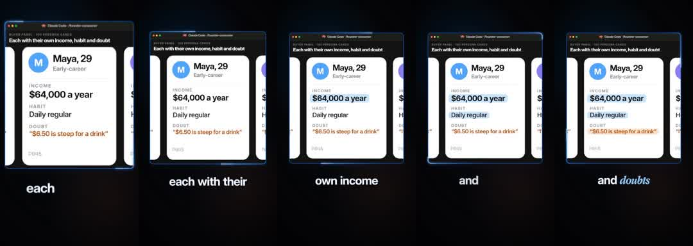

# v06_s12 · window_only · 24.1–26.5s (calidad 5)

- **Guion:** each with their own income, habits, and doubts,
- **Qué se ve:** Lienzo negro: carrusel horizontal de tarjetas de comprador; tarjeta central 'Maya, 29 · Early-career · $64,000 a year · Daily regular · "$6.50 is steep for a drink"' con vecinas cortadas a los lados. Se resaltan income, habit y doubt al decirlos. (observado 24.0–26.5)
- **Diseño:** Ventana oscura 'BUYER PANEL · 100 PERSONA CARDS' y ~13–40 %; tarjeta blanca radio grande, M en círculo azul; duda en naranja. Caption blanco a ~49 %; 'doubts' serif itálica azul claro.
- **Efectos:** Negro con glow azul del borde.
- **Animación:** Corte seco a 24.03; resaltado amarillo-azulado sobre '$64,000 a year' (25.0), 'Daily regular' (25.5), duda (26.0). Leve deriva/zoom de la tarjeta (inferido).
- **Por qué aquí:** Enumera atributos → se subraya cada atributo en la tarjeta.
