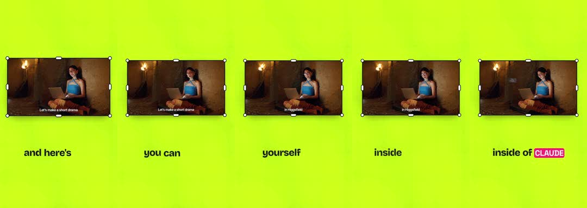

# v07_s03 · window_only · 4.6–6.8s (calidad 3)

- **Guion:** And here's how you can make them yourself right inside of Claude.
- **Qué se ve:** Sin título ni cara: la ventana sola centrada sobre el lima con clip de mujer en cueva con portátil y subtítulo interno 'Let's make a short drama' / 'in Higgsfield'. (observado 4.5–6.5)
- **Diseño:** Ventana x 8.5–91.5 % × y 29–55 %, asas blancas. Caption negro y≈73 %; 'CLAUDE' en caja magenta.
- **Efectos:** Lienzo lima con cuadrícula.
- **Animación:** Corte seco a 4.47: la ventana salta de posición (sin título/cara). Estática. (observado)
- **Por qué aquí:** Transición de 'qué pasa' a 'cómo hacerlo': se limpia la pantalla para el giro.
