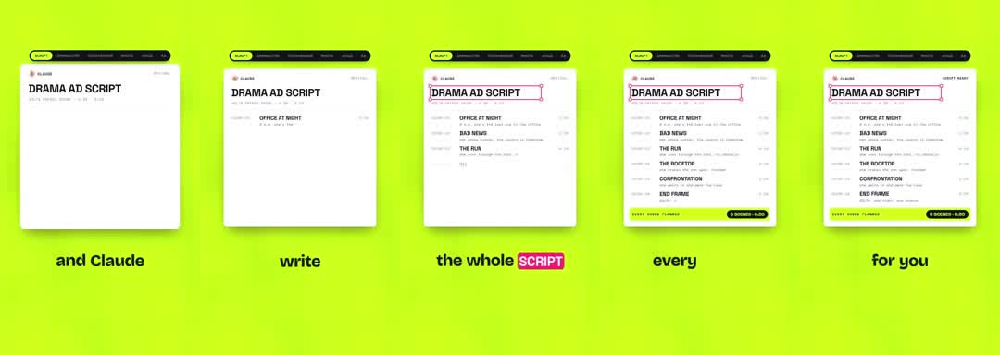

# v07_s07 · window_only · 15.1–18.2s (calidad 4)

- **Guion:** and Claude will actually write the whole script and plan every scene for you.
- **Qué se ve:** Lima sin cara: documento blanco vertical 'DRAMA AD SCRIPT' cuya lista de escenas (OFFICE AT NIGHT, BAD NEWS, THE RUN, THE ROOFTOP, CONFRONTATION, END FRAME) se escribe; barra de pestañas SCRIPT·CHARACTER·STORYBOARD·SHOTS·VOICE·AD con SCRIPT activo en lima. (observado 15.0–18.0)
- **Diseño:** Documento x ~25–75 % × y ~12–52 %; marco de selección magenta sobre el título a 16.25; caption y≈73 %, 'SCRIPT' caja magenta.
- **Efectos:** Sombra del documento.
- **Animación:** Documento entra con escala desde un poco más pequeño (~0.2 s, 15.3–15.5); líneas aparecen una a una (~0.4 s cada una).
- **Por qué aquí:** Describe lo que hace Claude → se ve el guion escribiéndose.
