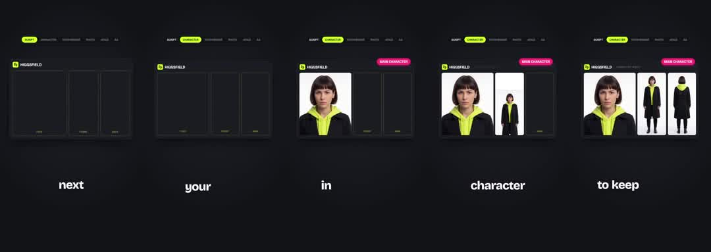

# v07_s08 · window_only · 18.2–21.6s (calidad 4)

- **Guion:** Next, it'll also create your main character in Higgsfield, with character sheets to keep looking
- **Qué se ve:** Lienzo casi negro: UI de Higgsfield con pestaña CHARACTER activa; tres huecos vacíos (FACE/FRONT/BACK), aparece retrato de la actriz (19.25) con chip 'MAIN CHARACTER' magenta y luego dos vistas de cuerpo entero (20.75). (observado)
- **Diseño:** Pestañas y≈15.5 %; ventana y≈26–55 %; caption blanco y≈73 %; 'CHARACTER' caja magenta.
- **Efectos:** Lienzo #101010 sin cuadrícula.
- **Animación:** Corte seco a 18.2 (cambio de lienzo lima→negro); imágenes pop en sus huecos.
- **Por qué aquí:** Cambio de herramienta (Higgsfield) = cambio de lienzo.
